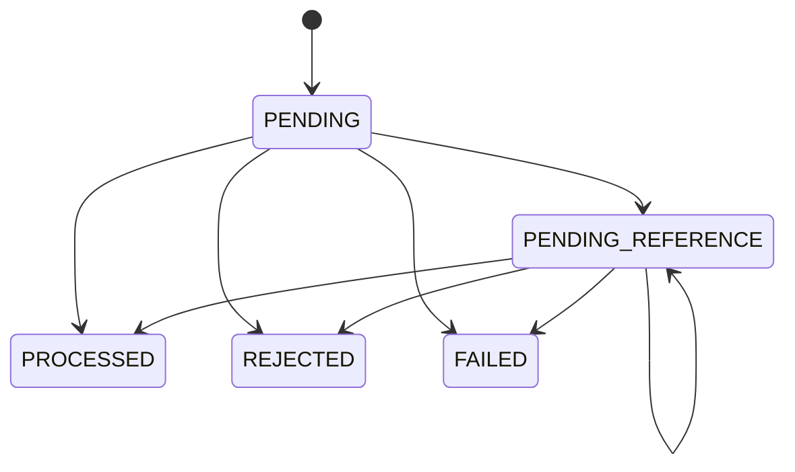

# Arquitetura e decisões

## Objetivo e limites

O serviço mantém a correção financeira sob concorrência, duplicação, entrega fora de ordem e falhas de processo. PostgreSQL é a autoridade para saldo, identidade das operações, ledger, inbox e outbox. SQS oferece transporte com entrega **at-least-once**; não é usado como garantia de unicidade financeira.

O projeto usa Bun 1.x, TypeScript estrito, NestJS, TypeORM e PostgreSQL. TypeORM foi escolhido entre as alternativas permitidas pelo enunciado pela integração simples com Nest e pelo controle explícito das transações. `EntitySchema` mapeia wallets; SQL parametrizado expressa locks, índices parciais, triggers e consultas de workers sem esconder sua semântica. Não há `synchronize`; mudanças de schema exigem migrations reversíveis.

## Fronteiras

- `domain`: classes encapsuladas, factories de criação/reidratação, invariantes e eventos, sem ORM ou Nest.
- `application`: o mesmo caso de uso para HTTP e SQS, coordenação transacional e portas de integração.
- `infrastructure`: PostgreSQL/TypeORM, migrations, SQS, configuração e telemetria.
- `http`: contratos externos, controllers e tradução consistente de erros.

`Money`, ledger, wallet, transação, inbox e outbox têm construtores privados ou protegidos. `create`/`open` verificam novas operações. `rehydrate` reconstrói estado persistido sem tentar repetir as regras de transição. Valores monetários e lançamentos são imutáveis; getters de datas do ledger retornam cópias.

## Representação monetária

`Money` armazena unidades mínimas como `bigint`, nunca `number`. Entrada e saída são strings decimais canônicas com exatamente duas casas. A implementação rejeita números JSON, sinais, expoentes, espaços, zeros iniciais redundantes e qualquer necessidade de arredondamento. Não existe arredondamento implícito: `1.001` é erro, não `1.00`.

PostgreSQL usa `numeric(28,2)`, retornado pelo driver como string. O limite máximo é `99999999999999999999999999.99`; o domínio verifica overflow antes da persistência. Valores negativos só existem em cálculos internos, como diferença de reconciliação. Contratos financeiros de entrada são não negativos. As moedas suportadas são BRL, USD e EUR, todas com escala 2; operações entre moedas diferentes falham. Não há conversão cambial nem suporte genérico a todas as escalas ISO-4217.

## Transação financeira e concorrência

Cada comando executa uma transação SQL em `READ COMMITTED`:

1. Verifica inbox persistida, quando houver.
2. Obtém `SELECT ... FOR UPDATE` somente na wallet envolvida.
3. Resolve idempotência e registra a transação inicialmente `PENDING`.
4. Valida a referência e aplica as regras de domínio.
5. Persiste resultado, lançamento, projeção do saldo, eventos da outbox e inbox.
6. Confirma o commit; só então responde ou permite o ack SQS.

O domínio calcula o lançamento; a trigger de inserção do ledger valida o saldo anterior e atualiza a projeção da wallet. Não há uma segunda atualização de saldo concorrente na aplicação. Triggers diferidas verificam as invariantes ao finalizar a transação. Uma falha em qualquer parte desfaz tudo.

O lock por wallet serializa comandos da mesma conta entre processos e containers. Wallets diferentes continuam independentes. `version` é uma revisão observável, não o mecanismo de lock: inicia em 1, abertura preserva 1 e cada movimentação posterior incrementa uma vez. `LOSS`, rejeições, referências pendentes e replay não incrementam a versão.

O lock tem timeout configurável, padrão 3 s. No HTTP, indisponibilidade/timeout permite retry com a mesma chave; no SQS, gera backoff. Um advisory lock é usado **somente durante migrations**, para coordenar alterações de schema, nunca no caminho financeiro.

### Garantias no banco

A migration aplica, além das verificações do domínio:

- unicidade de `(player_id, currency)`, chave de idempotência global e identidade `(provider_id, external_transaction_id)`;
- unicidade de `(transaction_id, wallet_id)` no ledger e de reversão processada por `(reference_transaction_id, kind)`;
- saldo não negativo, valores positivos nos lançamentos e aritmética `before ± amount = after`;
- vínculos entre wallet, moeda, player e transação; referências processadas, compatíveis e integralmente revertidas;
- ledger sem `UPDATE`, `DELETE` ou `TRUNCATE`, e transações terminais sem alteração/exclusão;
- saldo igual à soma do ledger, versão coerente, transação aplicada com seu lançamento e eventos obrigatórios, verificados no commit.

Essas proteções se aplicam a conexões comuns. Um administrador capaz de desabilitar triggers ou alterar o schema pode contorná-las; em produção a role da aplicação deve ter privilégios mínimos e migrations devem usar outra role.

## Idempotência e resultado original

Há duas identidades persistentes: a chave global e o par do provedor. HTTP exige `Idempotency-Key`, sem aceitar uma substituição no corpo; SQS usa `data.idempotencyKey`. O contrato é estrito: reutilizar uma identidade externa com outra chave também gera `409`.

O `payloadHash` é SHA-256, em hexadecimal, do JSON canônico destes campos: `providerId`, `externalTransactionId`, `playerId`, `walletId`, `roundId`, `gameId`, `kind`, `money` e `referenceExternalTransactionId` quando presente. Chaves de objetos são ordenadas recursivamente em ordem lexicográfica; campos `undefined` são omitidos; a ordem de arrays é preservada. Valores escalares usam a serialização JSON. O hash não inclui chave de idempotência, IDs de transporte, timestamps, correlação ou receipt handle. Os contratos estritos e a representação decimal canônica evitam formas monetárias alternativas.

As constraints únicas resolvem também a disputa de uma chave entre wallets diferentes. O resultado financeiro completo é persistido na transação. Um replay devolve seu saldo original, mesmo que a wallet já tenha recebido outras operações. Apenas `idempotentReplay` passa a `true`. Para uma operação ainda pendente, o replay devolve o estado persistido atual; a consulta permite acompanhar sua conclusão.

## Estados, referências e interpretações

`PROCESSED`, `REJECTED` e `FAILED` são terminais. Tentar transicioná-los lança erro de programação. Replay não executa uma transição.

| Operação | Interpretação                                                                      |
| -------- | ---------------------------------------------------------------------------------- |
| OPENING  | Interna, crédito inicial positivo; saldo inicial zero não gera transação ou ledger |
| BET      | Débito positivo; não aceita referência                                             |
| WIN      | Crédito positivo; referência opcional a BET processada da mesma rodada             |
| LOSS     | Valor `0.00`, sem ledger; referência opcional a BET processada                     |
| REFUND   | Crédito integral de BET processada, uma vez por referência                         |
| ROLLBACK | Inverte integralmente BET, WIN ou REFUND processada, uma vez por referência        |

Provider, player, wallet, moeda e rodada devem coincidir na referência. `gameId` é preservado e participa do hash; não é uma dimensão adicional exigida para a referência. Reversões parciais e referências a OPENING, LOSS ou outro ROLLBACK não são aceitas. A unicidade de reversão é **por tipo**, conforme o enunciado: uma BET pode ter um REFUND e um ROLLBACK, cada um uma vez. Não foi acrescentada uma proibição entre tipos que mudaria essa regra.

Referência ausente ou ainda não terminal mantém `PENDING_REFERENCE`. Referência terminal rejeitada ou falha resulta em `REFERENCE_NOT_PROCESSED`. Um worker consulta operações vencidas e adquire o mesmo lock de wallet, revalidando status e prazo dentro da transação. O padrão é dez tentativas de resolução; a primeira é imediata e as seguintes usam `REFERENCE_BACKOFF_MS × 2^attempt`, padrão 1 s, com expoente limitado a 16. Isso acomoda entrega fora de ordem em desenvolvimento sem manter pendências indefinidamente. No limite, persiste rejeição `REFERENCE_NOT_FOUND` e seu evento. A política deve ser ajustada ao SLA do provedor em produção.

### Taxonomia de rejeição

| `failureCode`                  | Significado                                                      |
| ------------------------------ | ---------------------------------------------------------------- |
| INSUFFICIENT_FUNDS             | BET sem saldo disponível                                         |
| REVERSAL_INSUFFICIENT_FUNDS    | Reversão de crédito produziria saldo negativo                    |
| CURRENCY_MISMATCH              | Moeda da operação diverge da wallet                              |
| PLAYER_MISMATCH                | Player não pertence à wallet                                     |
| REFERENCE_MISMATCH             | Identidade ou rodada da referência incompatível                  |
| REFERENCE_NOT_PROCESSED        | Referência terminou sem aplicação financeira                     |
| REFERENCE_KIND_INVALID         | Tipo de referência não permitido                                 |
| REFERENCE_AMOUNT_MISMATCH      | Tentativa de reversão parcial ou valor divergente                |
| REFERENCE_ALREADY_REVERSED     | Mesmo tipo de reversão já processado                             |
| REFERENCE_NOT_FOUND            | Limite de resolução esgotado                                     |
| WALLET_CAPACITY_EXCEEDED       | Crédito excederia a capacidade monetária                         |
| PERMANENT_INFRASTRUCTURE_ERROR | Falha técnica persistida após esgotar retries SQS; estado FAILED |

Erros de formato, referência obrigatória ausente e submissão externa de OPENING são erros de contrato `400`, anteriores à transação financeira. Os demais códigos HTTP estão no README.

## Inbox, retry e encerramento

A inbox persiste `(consumer_name, message_id)`, hash e resultado na mesma transação financeira. Seu hash considera `data`, incluindo a chave de idempotência, para detectar um `messageId` reaproveitado com outro comando. A deduplicação financeira continua protegendo mensagens com IDs de transporte diferentes.

O consumidor só apaga a mensagem após commit. Rejeições de negócio são resultados terminais e recebem ack. Mensagem inválida ou conflito permanente vai à DLQ; falha transitória altera a visibilidade com backoff `min(300, 2^min(receiveCount, 8))` segundos. O padrão é cinco recebimentos. A política de redrive SQS também usa cinco; deve ser alinhada a `SQS_MAX_ATTEMPTS` se esse valor mudar. No esgotamento, tenta persistir `FAILED` para comandos válidos antes da DLQ. Se PostgreSQL estiver indisponível, o envelope original na DLQ é o registro de recuperação e não se inventa um commit financeiro.

A visibilidade é renovada a cada 10 s para 30 s enquanto há processamento. SIGTERM/SIGINT interrompem novos ciclos, fecham o servidor HTTP e aguardam o trabalho em andamento. Ao atingir o prazo de drain, o consumidor devolve a visibilidade das mensagens em andamento e impede ack posterior dessas mensagens. I/O possui timeouts; o pool SQL só é encerrado depois que os workers concluem. O grace period do orquestrador deve exceder o prazo de drain e a conclusão do I/O. Se o processo for morto abruptamente, a visibilidade expira e outra instância reprocessa com segurança.

## Outbox e eventos

Eventos são subclasses concretas de `IntegrationEvent`, com tipo e versão 1 definidos na classe. O envelope persiste `eventId`, `eventType`, `version`, `aggregateId`, `correlationId`, `causationId` quando disponível, timestamp ISO e dados JSON com `MoneyProps`.

O publisher usa uma transação curta separada e `FOR UPDATE SKIP LOCKED` para reservar uma linha vencida. A linha só fica visível depois do commit financeiro. Dois publishers podem avançar sem reservar a mesma linha ao mesmo tempo. O envio SQS ocorre enquanto essa linha está bloqueada; sucesso marca publicação, falha agenda retry exponencial de 1 s até 60 s, sem limite que descartaria eventos confirmados.

Existe uma janela inevitável entre enviar ao SQS e confirmar `published_at`. Um crash nessa janela causa reenvio com o **mesmo `eventId`**. A deduplicação FIFO reduz duplicatas por sua janela temporária; consumidores externos devem manter inbox persistente por `eventId`. Não se promete exactly-once, nem ordem causal estrita de publicação entre publishers. Consumidores que materializam saldo devem usar `walletVersion` ou reconstruir o estado por uma fonte autoritativa.

Morte após o commit financeiro e antes de publicar deixa a outbox pendente para outra instância. `LOSS` emite `WagerTransactionProcessed`, sem `WalletBalanceChanged`; rejeições e pendências emitem seus próprios eventos. Abertura positiva gera os eventos de transação e saldo na mesma transação SQL.

## Consultas e reconciliação

Ledger usa sequência monotônica e cursor base64url opaco com wallet, última sequência e limite superior capturado na primeira página. Novos lançamentos não deslocam páginas em andamento. Cursor de outra wallet, limite fora de 1–100 ou conteúdo inválido é rejeitado. O cursor não é credencial nem assinatura; autorização deve ser tratada separadamente.

Reconciliação lê projeção e soma do ledger em **uma única consulta MVCC**, evitando uma divergência fabricada por commits entre duas leituras. Retorna diferença assinada, contagem e consistência. Uma divergência gera log e contador e nunca uma correção automática.

## Observabilidade

Logs JSON incluem identificadores de correlação, mensagem, transação, wallet e provider quando disponíveis. Há uma lista explícita de campos permitidos: comandos, saldos, tokens e payloads completos não são registrados. Uma mensagem inválida pode não fornecer IDs seguros para correlação.

`/metrics` expõe `wager_transactions_total`, `wager_duplicates_total`, `wager_retries_total`, `wager_dlq_total`, `wager_lock_conflicts_total`, `wager_outbox_lag_seconds`, `wager_processing_seconds` e `wager_reconciliation_divergences_total`. Métricas são locais ao processo e devem ser coletadas de todas as instâncias; contadores operacionais não substituem auditoria SQL. Não há labels com IDs de alta cardinalidade.

Liveness verifica o processo. Readiness consulta PostgreSQL e os atributos das três filas; falha retorna 503. Ambos ficam abertos.

## Autenticação e evolução para produção

Autenticação foi omitida conscientemente, conforme permitido na seção 2, para priorizar os critérios financeiros. `ProviderIdentityPort` e `DevelopmentProviderIdentity` explicitam o ponto de substituição; a implementação de desenvolvimento é no-op. Portanto, `providerId` recebido por HTTP **não é identidade autenticada**.

Em produção, um adapter validaria JWT de um IdP externo OIDC (Keycloak, Zitadel ou equivalente): assinatura/JWKS, issuer, audience, expiração e scopes. Vincularia um claim confiável ao provider do comando, sem tabela própria de senhas. Consultas e criação de wallets precisariam também de autorização por proprietário/operador. Health permaneceria aberto; SQS seria um canal interno com IAM restrito e suas identidades de domínio continuariam validadas.

Outros limites deliberados: ledger de entrada simples (double-entry era opcional), ausência de benchmark de carga, retenção/arquivamento de inbox/outbox não automatizados, nenhuma interface de replay de DLQ, TLS/segredos/IAM de produção fora do Compose local. As triggers diferidas somam o histórico da wallet para verificar saldo e versão; o custo cresce com seu ledger e deve ser medido antes de adotar essa proteção em contas de alto volume. Não há promessa de throughput ou avaliação de capacidade derivada dos testes de correção. Backups, recuperação point-in-time, limites por provedor, alarmes, privacidade dos IDs e políticas de retenção devem ser definidos antes de operar dinheiro real.

## Validação

Os testes de integração usam PostgreSQL e SQS LocalStack reais, bancos e filas isolados por execução, processos Bun separados e falhas injetadas somente nos pontos necessários para tornar crash/retry reproduzíveis. Após cada teste, todas as wallets são reconciliadas ao ledger e à versão esperada. A [matriz de requisitos](docs/REQUIREMENTS.md) registra a correspondência entre enunciado, implementação e evidência executável.
